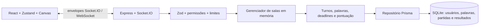

# Arquitetura

## Fluxo de uma ação

1. O cliente envia um envelope tipado, com ID, timestamp e payload.
2. O servidor valida estrutura, tamanho, frequência, sessão e permissão.
3. O gerenciador aplica a ação ao estado da sala.
4. O servidor confirma a ação e transmite o evento/estado atualizado aos sockets autorizados.
5. O cliente atualiza Zustand e renderiza jogadores, chat, pontuação e canvas.

O cliente não determina identidade de outro jogador, resultados, deadlines ou a palavra aceita. Os timestamps enviados pelo navegador são metadados, não autoridade de jogo.

## Estado e transições

O fluxo é `lobby → choosing → drawing → round_end → choosing/finished`. O host inicia; a seleção de palavras é privada; os demais podem adivinhar durante o desenho. Todos os elegíveis acertando ou o deadline terminando encerram o turno. Ao final, o resultado é gravado antes de emitir `game:finish`. Jogar novamente cria um novo ciclo com pontuação zerada.

Uma rodada configurada significa um ciclo completo de desenhistas. Três jogadores e uma rodada geram três turnos. O servidor mantém a sequência dos turnos, inclusive ao tratar saídas.

## Desenho

O canvas usa pontos normalizados e redesenha a lista de traços recebida. Resize e telas com dimensões diferentes preservam o conteúdo. Cada traço registra cor, largura e ferramenta; borracha usa a mesma superfície lógica. Undo/redo são ações do servidor. Entrantes e reconexões recebem o desenho atual junto ao snapshot, dispensando replay de toda a rede.

Apenas o desenhista pode modificar o desenho. A autorização ocorre no backend; o frontend também desabilita os controles para orientar o jogador.

## Reconexão

O servidor cria um token imprevisível e associa a sessão ao ID do jogador. Ao perder conexão, a presença passa a desconectada e um timer de tolerância começa. Voltar com o mesmo token cancela a remoção e recupera a participação sem duplicação. Sair explicitamente remove a participação imediatamente.

Se o prazo expirar, o participante é removido; o host é transferido a um participante disponível, e o servidor trata o turno afetado quando o desenhista sai. Token e sala ativa são dados de memória: não sobrevivem a reinícios do processo.

## Persistência

O schema Prisma contém:

| Modelo | Conteúdo |
|---|---|
| `User` | Perfil de jogador e pontuação/acertos/partidas/vitórias acumulados |
| `Word` | Palavra, categoria e dificuldade, com texto único |
| `Match` | Sala, início/fim, duração, turnos e configurações |
| `MatchResult` | Resultado individual, pontuação, acertos e posição |

O seed fornece mais de 200 palavras classificadas. Os testes de integração usam um SQLite temporário com migrations aplicadas; fazem ações com clientes Socket.IO reais e conferem resultados persistidos pelo endpoint de ranking.

## Segurança e limites

- Zod valida os envelopes e payloads; dados desconhecidos/privilegiados são rejeitados.
- Coordenadas, cores, espessura e número de pontos são limitados.
- Há limites de frequência, tamanho de mensagens, histórico e desenho para conter uso excessivo de memória.
- O servidor autoriza host/desenhista/jogador para cada ação e isola broadcasts por sala.
- Snapshots são produzidos por destinatário para proteger opções e palavra privada.
- Mensagens removem caracteres de controle e delimitadores de tags; React renderiza texto.
- O backend usa headers de proteção e origens configuradas. Logs estruturados facilitam acompanhar erros.
- Tokens não equivalem a uma conta de usuário: a identidade persistente representa uma sessão de jogador, sem autenticação de conta.

TLS deve ser fornecido pelo serviço de hospedagem ou proxy em produção. Não exponha arquivos SQLite nem tokens em URLs/logs públicos.

## Escala e evolução para Redis

A versão entregue executa uma instância Node.js; o SQLite é adequado a essa implantação e fica em volume persistente. Salas, tokens, desenho e timers ativos pertencem ao processo. Reiniciar esse processo perde partidas em andamento, mas preserva resultados concluídos no banco.

Um adaptador Redis do Socket.IO sozinho não distribui a lógica do jogo. Para executar várias instâncias, também será necessário:

1. Armazenar salas, sessões, traços e prazos em um serviço compartilhado.
2. Garantir um único responsável por cada turno/deadline, com locks ou eleição de proprietário.
3. Fazer atualizações atômicas e idempotentes para acertos e conclusão de partidas.
4. Usar adaptador Socket.IO para broadcasts entre processos.
5. Trocar SQLite por banco adequado ao acesso concorrente de várias instâncias e incluir observabilidade de rede.

O gerenciador usa a interface ActiveRoomStore, com MemoryActiveRoomStore como implementação atual. Um futuro adaptador deve substituir esse armazenamento e coordenar ownership dos timers, além do adaptador Socket.IO. A separação entre gerenciador, contratos e repositório reduz o acoplamento para essa evolução; Redis não está habilitado nesta entrega. Jogadores que entram durante uma partida podem adivinhar e pontuar; seu turno de desenho começa na próxima partida.
